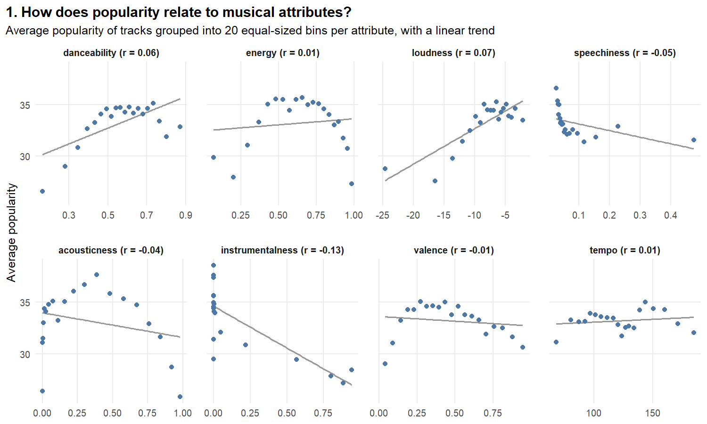
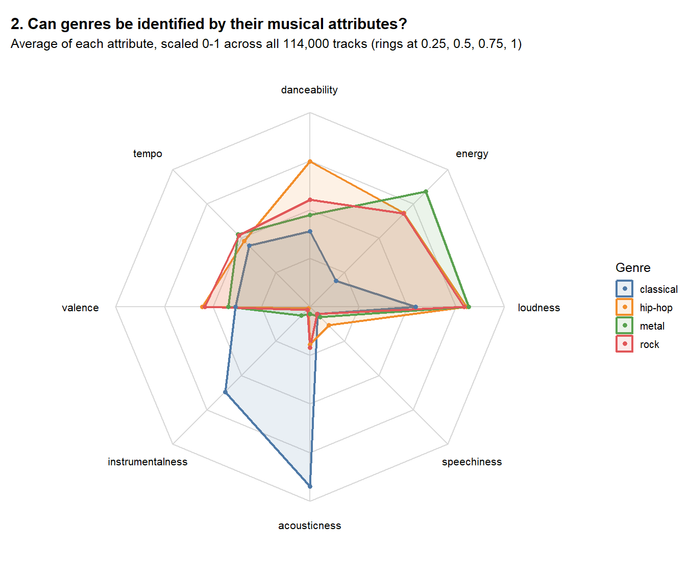
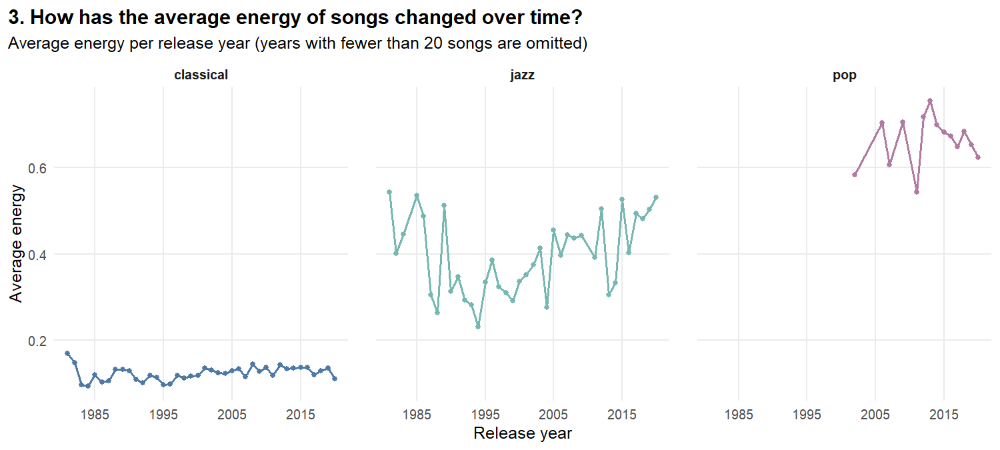
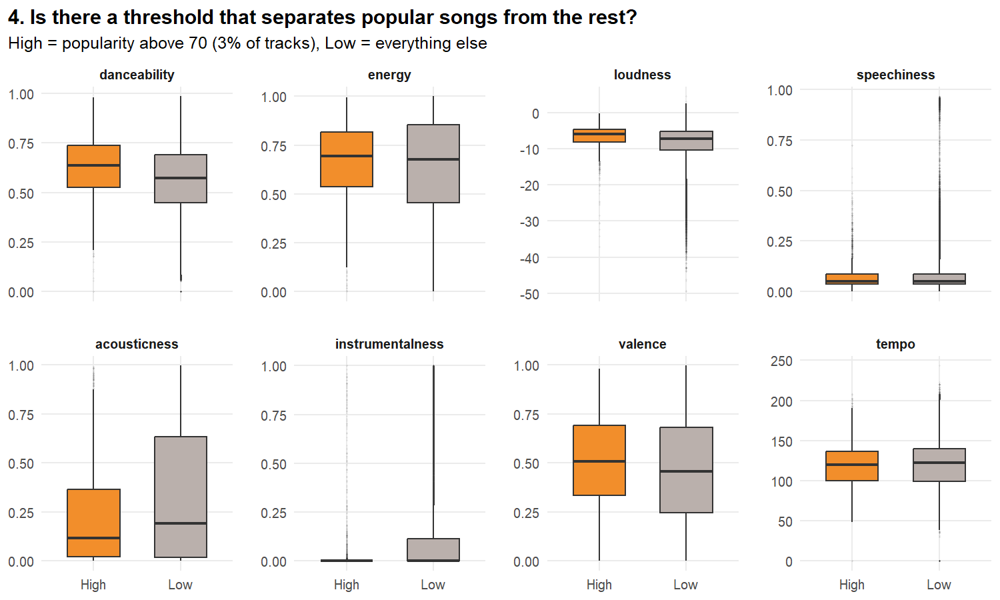
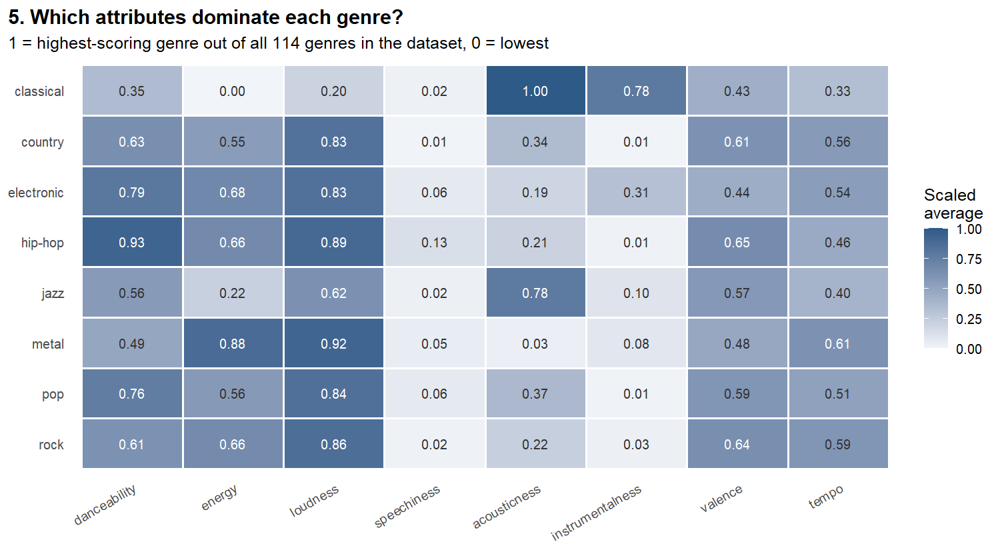
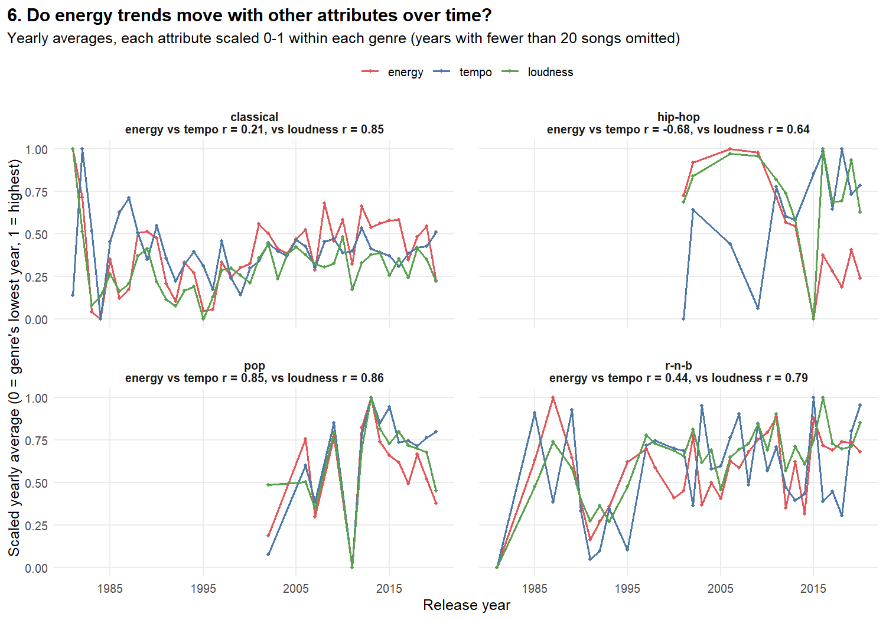
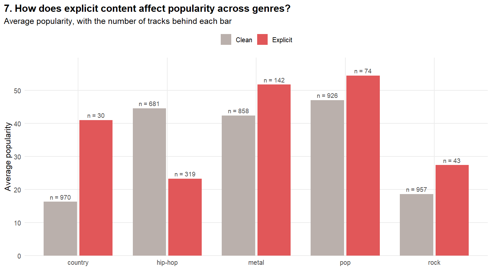

# What Makes a Song Popular? Exploring 114,000 Spotify Tracks

An exploratory data visualisation project asking how a song's audio features (danceability, energy, loudness, tempo and so on) relate to its popularity, its genre and its release year. Everything, from cleaning the raw data to drawing the charts, is done in R and rebuilt with a single command.

## How it works

- **dplyr and tidyr** clean, combine and aggregate two public Spotify datasets. Each question has its own script in `scripts/`, which writes a small dataset to `data/processed/`.
- **ggplot2** draws every chart from those datasets (`scripts/plot_charts.R`), using small multiples where comparing every attribute in one panel would be unreadable.

The original coursework version used interactive charts in an Observable notebook. When I revisited the project, I rebuilt the charts in R so the whole analysis lives in one reproducible repository.

The project starts with four broad questions, then follows each one up with a narrower question based on what the first chart showed.

## Questions and findings

### 1. How does popularity relate to musical attributes?



Every relationship is weak. Across 89,741 unique tracks, the clearest pattern is that **instrumental tracks tend to be less popular** (correlation −0.13). Louder and more danceable tracks are very slightly more popular (0.07 and 0.06), and no other attribute reaches ±0.05. The binned averages show why some correlations are near zero: popularity peaks at *moderate* energy and danceability and falls at both extremes, a curved pattern a straight-line correlation can't capture. Popularity depends far more on things this dataset doesn't capture, such as the artist and marketing. The full table is in [`data/processed/q1_correlations.csv`](data/processed/q1_correlations.csv).

### 2. Can genres be identified by their musical attributes?



Some can, clearly. With every attribute scaled 0–1 across the whole dataset, **classical** stands apart: highly acoustic (0.92) and instrumental (0.62), with low energy (0.19). **Metal** has the highest energy (0.84) and is the least acoustic (0.04). **Hip-hop** is the most danceable (0.75) and the most speech-heavy (0.14). Rock is the hardest to pin down: it sits between metal and hip-hop on almost everything, separated from metal mainly by lower energy and higher acousticness, and from hip-hop by lower danceability and speechiness.

### 3. How has the average energy of songs changed over time?



Each genre tells a different story. **Classical** has barely changed in 40 years, staying low at around 0.11–0.13. **Jazz** changed the most: its energy dipped in the 1990s (0.32 on average) and then climbed steadily, reaching 0.45 in the 2010s, with recent years above 0.5. **Pop** has the highest energy throughout, but the data only supports it from 2002 onwards. It peaked around 2012–2014 (0.72 on average) and eased to about 0.65 by 2018–2020.

| Average energy | 1981–90 | 1991–2000 | 2001–10 | 2011–20 |
|---|---|---|---|---|
| Classical | 0.13 | 0.11 | 0.13 | 0.13 |
| Jazz | 0.40 | 0.32 | 0.40 | 0.45 |
| Pop | – | – | 0.64 | 0.67 |

### 4. Is there a threshold that separates popular songs from the rest? *(follows up question 1)*



No. Only 2,733 of the 89,741 unique tracks (3%) have a popularity above 70, and their attribute distributions overlap almost completely with everyone else's. The differences that do exist are small: popular tracks are slightly louder (median −6.0 dB against −7.2 dB), more danceable (0.64 against 0.57), happier in mood (valence 0.51 against 0.46) and less acoustic (0.12 against 0.19).

### 5. Which attributes dominate each genre? *(follows up question 2)*



Each cell compares a genre with all 114 genres in the dataset: 1 means the highest-scoring genre of all, 0 the lowest. Classical is the most acoustic genre in the entire dataset and one of the most instrumental. Metal is the most energetic and loudest of the eight genres shown, and hip-hop is the most danceable and the most positive in mood (valence). Speechiness is close to 0 for all eight because a few spoken-word-heavy genres set the top of the scale.

### 6. Do energy trends move with other attributes over time? *(follows up question 3)*



Mostly, yes. In every genre, years with louder songs on average are also years with more energetic songs (correlations from 0.64 in hip-hop to 0.86 in pop). That's partly built into the data, since Spotify calculates energy partly from loudness. Tempo is more genre-specific: in **pop**, energy and tempo rise and fall almost in step (0.85), in R&B they're moderately linked (0.44), and in classical barely at all (0.21). **Hip-hop** is the exception: years with faster songs tend to be *less* energetic (−0.68), though that's based on only 13 years of data. The correlations are in [`data/processed/q6_correlations.csv`](data/processed/q6_correlations.csv).

### 7. How does explicit content affect popularity across genres?



It depends on the genre, but most of the dramatic differences rest on very few songs. Explicit country songs average a popularity of 41 against 16 for clean ones, but that's based on just 30 explicit country tracks out of 1,000. Rock's explicit group is similarly small (43 tracks). **Hip-hop is the only genre with a large explicit group (319 tracks), and there explicit songs are less popular** (23 against 45). In pop and metal, explicit songs score higher, from groups of 74 and 142 tracks.

## What I fixed when revisiting the project

While preparing this repository I re-checked the original coursework and corrected these problems:

1. **The genre profiles (question 2) were scaled within each genre**, so every genre was measured against itself and the chart couldn't actually compare them. Attributes are now scaled across the whole dataset.
2. **Release years were matched by song title.** Songs that share a title, like "Intro" or "Home", picked up release dates from unrelated tracks. Matching properly showed the two datasets barely overlap: only about 9% of tracks could be reliably matched, even by Spotify ID plus title and artist, because Spotify gives every release of a song its own ID. So the over-time questions now use the second dataset's own audio features and release years, labelled with genres by artist (see Limitations).
3. **Release dates given only as a year were silently dropped**, because the date parser couldn't read them. The year is now read directly.
4. **About a fifth of rows were duplicates.** The same track appears once for each genre it's listed under, which double-counted those tracks in the popularity analyses (questions 1 and 4). Those now count each track once.
5. **Trends were judged by eye.** Questions 1 and 6 now report correlation coefficients, question 7 shows how many tracks are behind each bar, and years built from fewer than 20 songs are excluded from the time charts.

## Limitations

- **Popularity is a snapshot.** It's Spotify's popularity score at the time the dataset was collected, which reflects recent listening, so older songs are at a disadvantage.
- **The genres are a balanced sample.** The main dataset holds 1,000 tracks per genre, so it doesn't reflect how common each genre really is.
- **Genres in the over-time charts come from the artist.** Songs in the 1.2M dataset are labelled with the genres their primary artist has in the main dataset. An artist listed under several genres contributes to each of them, and an artist's older songs may not fit the genre they're labelled with today. This covers 194,075 songs by 5,433 artists, but coverage varies by genre: pop only has enough songs per year from 2002 onwards. For classical, the "artist" is often the composer, so the year reflects when a recording was released, not when the music was written.
- **Release years use the earliest version found.** When a song appears several times (album, single, compilation), the earliest year is treated as its original release.
- **Correlation isn't causation.** These are associations in a sample, not effects.

## Data

| Dataset | Used for |
|---|---|
| [Spotify Tracks Dataset](https://huggingface.co/datasets/maharshipandya/spotify-tracks-dataset) by Maharshi Pandya: 114,000 tracks across 114 genres (BSD licence) | All questions |
| Spotify 1.2M+ Songs (Kaggle): 1.2 million tracks with release years | Questions 3 and 6 |

## Reproducing it

Requirements: R with the `dplyr`, `tidyr` and `ggplot2` packages.

1. Download both datasets into `data/raw/` (see [`data/raw/README.md`](data/raw/README.md)).
2. From the repository root, run:
   ```bash
   Rscript run_all.R
   ```
3. Each script prints its key numbers. Datasets are written to `data/processed/` and charts to `charts/`. Questions 1 and 4 produce large track-level files that aren't committed; the rest are small summaries and are included.

## Project structure

```
run_all.R                               Runs every script in order
scripts/helpers.R                       Shared settings and functions
scripts/00_join_release_years.R         Builds the over-time dataset (for Q3 and Q6)
scripts/q1_popularity_vs_attributes.R   One script per question...
scripts/q7_explicit_popularity.R
scripts/plot_charts.R                   Draws all seven charts
data/processed/                         Datasets behind each chart
charts/                                 The charts shown in this README
```

Built as part of my BSc Computer Science with Artificial Intelligence at the University of Nottingham.
